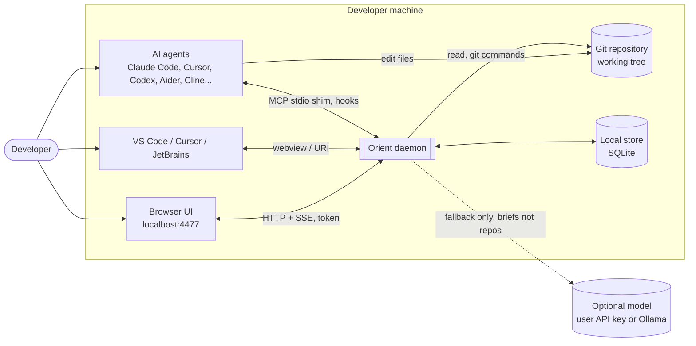
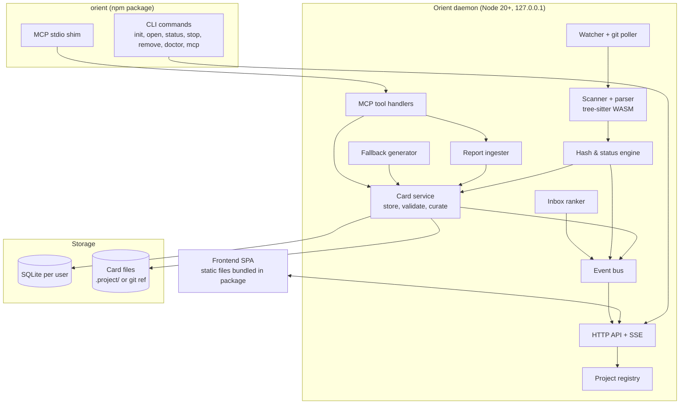
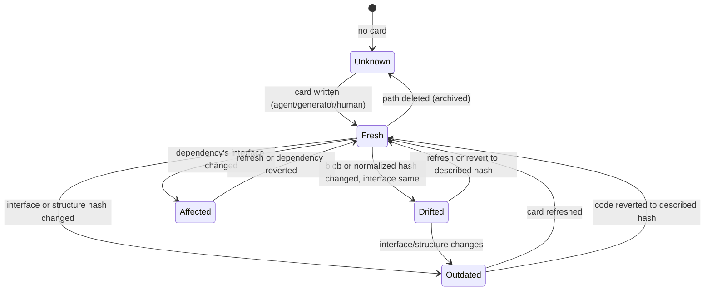
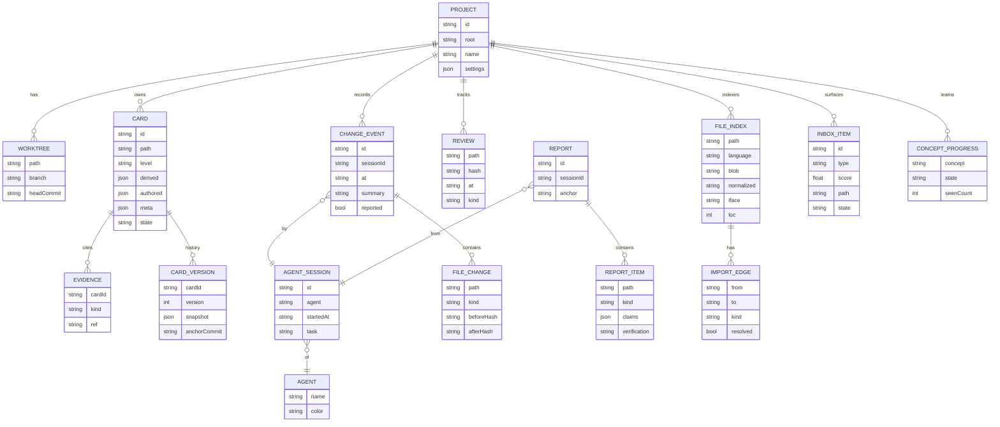
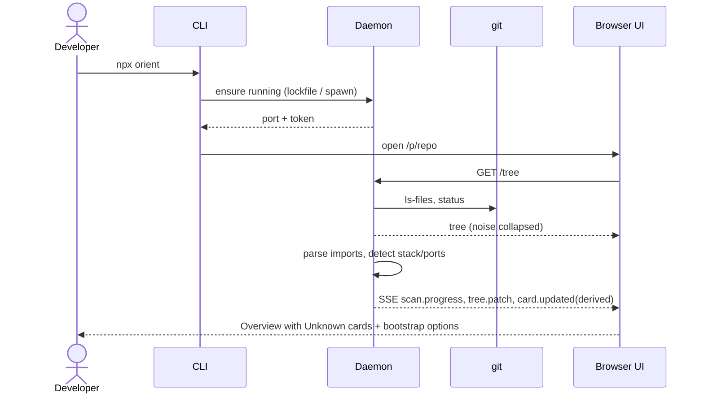
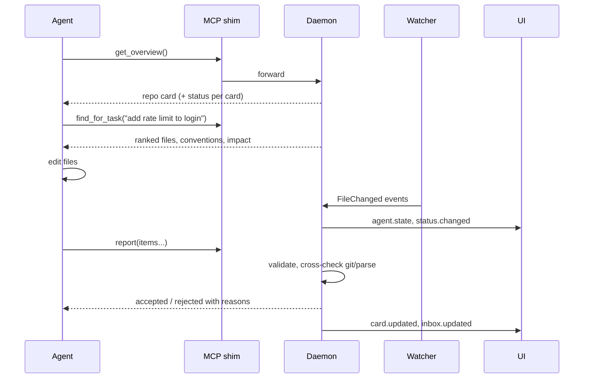
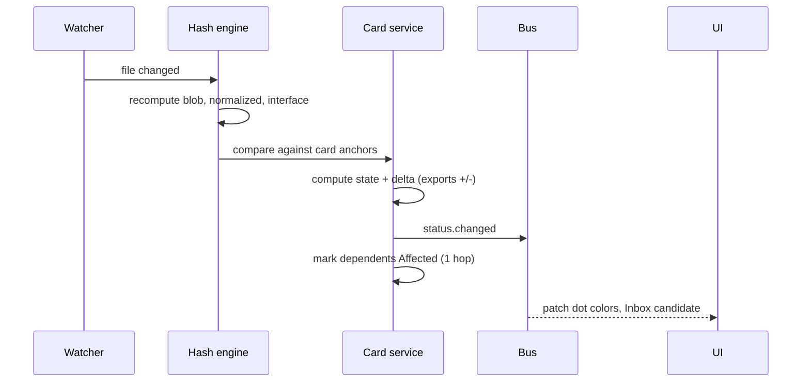
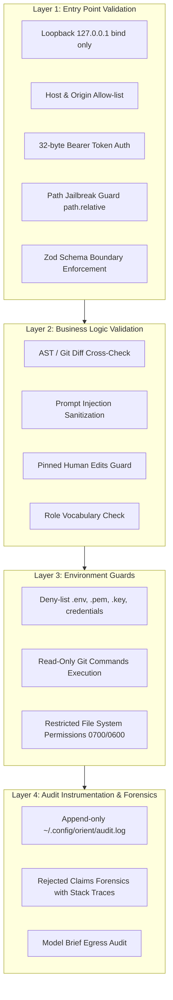

# Orient — Architecture Document

> **Version:** 0.1 | **Companion docs:** `PRD.md`, `DESIGN.md`
> Diagrams use Mermaid and render in GitHub, VS Code, and most Markdown viewers.

---

## 1. Architectural principles

1. **Local-first.** Everything runs on the developer's machine. No account. No code upload by default.
2. **Git is the source of truth for *what*;** agents are the source of truth for *why*.
3. **Deterministic before generative.** Facts (imports, routes, hashes) come from parsing. LLMs only supply narrative, and every claim is validated.
4. **The agent pays.** Agents report to Orient; Orient avoids running its own LLM except as a cached, last-resort fallback.
5. **Derived vs authored.** Derived fields are recomputed (never stale). Only authored fields can go outdated.
6. **One daemon, many surfaces.** UI, MCP server, CLI, editor extension are thin clients of one local API.
7. **Typed contracts.** One shared schema package drives daemon, MCP, and frontend.
8. **Graceful degradation.** Unknown language, no hooks, no LLM: still show tree, hashes, and honest "unknown".

---

## 2. System context



---

## 3. Container view



---

## 4. Components

### 4.1 CLI (`orient`)
| Command | Behavior |
|---|---|
| `init` | Detect git root and agents; show **diff preview**; write MCP entry / hook / rules snippet per agent after confirmation; register repo |
| `open` (default) | Ensure daemon running (read lockfile, health check, spawn if absent); open browser to `/p/<repo>` |
| `status` | Daemon pid, port, registered repos, agent connections |
| `stop` | Graceful shutdown |
| `remove` | Revert every written config using recorded manifest; optionally delete local data |
| `doctor` | Check git, Node version, port, permissions, agent configs, report health |
| `mcp` | stdio shim launched by agents; ensures daemon is running and proxies MCP calls |
| `export` | Write `AGENTS.md` / `.project/context.json` snapshot |
| `ci` / `verify` | Headless execution: check staleness, unreported changes, and card validity against configurable thresholds; exits 0 (clean) or 1 (policy breach) |

**Config write manifest:** every file modified by `init` is recorded (`path`, `before-hash`, `inserted-block-id`) so `remove` is exact.

### 4.2 Daemon lifecycle, liveness, and self-healing
- One **global daemon per user**, many repos.
- Default port `4477`; on conflict try `4478..4499`; write the real port to `~/.config/orient/daemon.json` (`pid`, `port`, `token`, `startedAt`).
- **Zombie Lockfile Cleanup:** On startup, if `daemon.json` exists, probe the recorded PID with `process.kill(pid, 0)`. If stale, clean lockfile and reclaim port automatically.
- **Cache Self-Healing:** The SQLite database is an ephemeral cache. If corrupted or missing, the daemon transparently regenerates indexes from the working git tree and durable `.project/cards/*.json` files.
- Bind `127.0.0.1` only. Cryptographic 32-byte hex token per run required on API and SSE (`0600` permissions on token file). Validate `Host` and `Origin` against loopback allow-list (blocks DNS rebinding and cross-site calls).
- Started by: `orient open`, the MCP shim, or optional login item.
- Idle shutdown option (default off while any agent connection exists).

### 4.3 Project registry
Maps repo root -> `projectId`, branch/worktree set, settings, last opened. Resolves worktrees (`git worktree list`) so agents in separate worktrees roll up to one project.

### 4.4 Watcher and git poller
- File events via `chokidar`/native watchers, debounced (200 ms), filtered by `.gitignore` and deny-list.
- Git poll (HEAD, index, `git status --porcelain=v2`, `git ls-files -s`) on events and every 30 s as safety net.
- Emits `FileChanged`, `TreeChanged`, `HeadChanged`.

### 4.5 Scanner and parser
- Tree from `git ls-files` plus untracked non-ignored.
- **Noise classifier:** directories like `node_modules`, `dist`, `build`, `.next`, `target`, `__pycache__`, `venv`, lockfiles, minified/generated files (header markers) -> `noise` group.
- **Language-agnostic parse** with tree-sitter WASM. Extractors per language produce a common record:

```ts
interface ParsedFile {
  path: string; language: string; blobHash: string;
  normalizedHash: string;       // AST hash ignoring comments/whitespace
  interfaceHash: string;        // hash of exports, signatures, routes, imports
  imports: ImportRef[];         // module, resolved path?, symbols
  exports: ExportSym[];         // name, kind, signature
  routes: RouteDef[];           // method, path, handlerRef (best effort)
  envVars: string[]; ports: number[];
  todoCount: number; loc: number;
}
```
- Import resolution: relative paths and package manifests first; LSP/SCIP integration is a later optional enhancer.
- Repo-level detectors: stack (manifests), entry points (scripts, `main`, Dockerfile CMD), run commands, ports (compose, `.env.example`, config), env var inventory, test locations/commands.

### 4.6 Hash and status engine
Hash kinds:

| Hash | Source | Meaning |
|---|---|---|
| `blob` | `git hash-object` / index | Any byte changed |
| `normalized` | AST sans trivia | Logic body changed |
| `interface` | Exports/signatures/routes/imports | Public surface changed |
| `structure` | Sorted child names + kinds | Files added/removed/renamed |
| `tree` | `git rev-parse HEAD:dir` | Anything under folder changed |

**Card state machine**



Rules:
- Folder card is **Outdated** only when its `structure` hash or any child's `interface` hash changes.
- **Affected** is computed from the reverse import graph, one hop by default.
- Content-addressed lookup: if a path returns to a previously described hash (revert, branch switch), the old card becomes Fresh again.
- Renames: same blob hash at new path -> card moves (git rename detection for near matches).
- Uncommitted work: anchor = `(HEAD commit, working-tree blob hashes)`; agent reports anchor to the snapshot they saw.

### 4.7 Card service
Responsibilities: persist, validate, version, serve, curate.

**Card schema (shared package)**

```ts
type Role =
  | 'entrypoint' | 'routes' | 'controllers' | 'services' | 'repositories'
  | 'models' | 'migrations' | 'middleware' | 'ui-components' | 'ui-pages'
  | 'state' | 'hooks' | 'utils' | 'config' | 'infra' | 'scripts'
  | 'tests' | 'fixtures' | 'docs' | 'assets' | 'generated' | 'vendor' | 'other';

interface Card {
  id: string;                    // stable: projectId + path
  level: 'repo' | 'folder' | 'file';
  path: string;

  // derived (recomputed, never stale)
  derived: {
    fileCount: number; loc: number; languages: string[];
    keyFiles: { path: string; reason: string }[];      // by import centrality
    dependsOn: string[]; usedBy: string[];
    surface: { routes: RouteDef[]; exports: string[]; envVars: string[]; tables: string[]; ports: number[] };
    tests: { present: boolean; paths: string[]; command?: string };
    health: { lastChanged: string; todoCount: number; hasTests: boolean };
  };

  // authored (can go outdated)
  authored: {
    purpose: string;               // <= 140 chars
    role: Role;
    why: string;                   // tied to user request, <= 200 chars
    oneThing: string;              // <= 12 words
    conventions: string[];         // <= 5, each <= 120 chars
    doNot: string[];               // <= 5
    decisions: { choice: string; alternatives?: string[]; reason?: string }[];
    representativeFile?: { path: string; snippetRange: [number, number] };
    contrast?: string;             // "uses X instead of Y"
  };

  meta: {
    source: 'agent-reported' | 'generated' | 'human';
    agent?: { name: string; sessionId?: string; color: string };
    confidence: 'high' | 'medium' | 'low';
    evidence: Evidence[];          // file:line, import edges
    anchor: Anchor;                // hashes at description time
    pinned: boolean;               // human-edited
    createdAt: string; updatedAt: string;
    origin?: { commit?: string; promptSummary?: string };
  };
}

interface Anchor { commit: string; blob?: string; tree?: string; normalized?: string; interface?: string; structure?: string; }
interface Evidence { kind: 'file' | 'line' | 'import' | 'route' | 'config'; ref: string; note?: string }
```

**Validator (hard gate before storing/displaying authored fields)**
- Every `path`, `keyFiles`, `representativeFile`, `routes`, `exports` referenced must exist in the parsed index.
- Length caps and character whitelist; strip markup, URLs-as-instructions, imperative-to-model phrasing.
- Role must be in vocabulary.
- Failures downgrade the card to `confidence: low` or reject with reason returned to the reporting agent.

**Curator (mostly deterministic)**
- Ranks key files by import centrality, top 3 on face, rest under "more".
- Chooses which findings to surface by severity.
- Chooses depth per user preference/behavior (face vs expanded).
- Orders **Start Here** path: entrypoint first, then folders by dependency direction (models before services before routes), capped at 6, labeled "suggested".
- Concept chips: only concepts not yet dismissed by the user.

### 4.8 Report ingester (agent write-back)
Event-driven, not continuous. Trigger events: new folder, new dependency, new route, new port/env var, task end.

```ts
interface Report {
  agent: { name: string; sessionId?: string };
  taskSummary: string;           // <= 140 chars
  anchor: { commit: string; workingTreeHash?: string };
  items: {
    path: string; kind: 'created' | 'modified' | 'removed' | 'moved';
    role?: Role; why?: string; decisions?: Decision[];
    surface?: { routes?: string[]; envVars?: string[]; ports?: number[]; deps?: string[] };
    confidence?: 'high' | 'medium' | 'low';
  }[];
}
```
Pipeline: schema validate -> cross-check against git diff and parse -> label each claim `verified` (matches reality) or `agent-said` (plausible, unchecked) -> write/merge cards -> emit events. Changes seen by the watcher with no matching report become **Unreported** items.

Channels (priority order): hook (end-of-turn/post-edit) > MCP `report` > repo manifest edit > transcript reader (best effort, optional adapter).

### 4.9 Fallback generator (optional LLM)
- Triggered only for: Unknown cards, Outdated cards a user opens or requests, bootstrap on user click.
- Input: compact deterministic brief (tree slice, exports, imports, routes, previous card, diff). Never whole files unless a small representative snippet.
- Output: strict JSON per card schema; cheap critic pass removes sentences unsupported by the brief.
- Cached by `(path, interfaceHash, structureHash)`.
- Backends: none (default), user API key, local Ollama.
- **Bootstrap-with-your-agent:** generates a one-time prompt telling the user's agent to fill `.project/cards/*.json` per schema; Orient validates on arrival.

### 4.10 Inbox ranker
Candidate items: Unreported change, Outdated card on recently edited path, Collision, Failing test, New dependency, New port/env var, Changed since reviewed.

Score = `severity x recency x (1 - alreadySeen)`; severity weights: security-sensitive path (auth, secrets, payments) and deletions highest; dependency additions high; tests missing for changed code medium. Cap at 5 visible. Items auto-resolve when marked reviewed or when the underlying card refreshes.

### 4.11 Event bus and SSE
Typed events pushed to the UI; the UI patches local state, never refetches the tree.

| Event | Payload |
|---|---|
| `scan.progress` | phase, done, total |
| `tree.patch` | added/removed/renamed nodes |
| `card.updated` | cardId, status, source |
| `status.changed` | path, from, to |
| `agent.state` | agent, task, step |
| `inbox.updated` | items |
| `report.received` | agent, accepted, rejected |

### 4.12 Agent attribution
Best-effort cascade: hook/MCP identification -> known agent session files and process names -> heuristics (large multi-file burst with no user editor focus) -> `unknown`. Each agent gets a stable color from a fixed palette seeded by name. Never guess silently: unknown stays unknown.

### 4.13 Multi-agent concurrency and optimistic locking
When multiple agents (or an agent and a human) interact with Orient simultaneously:
- **Optimistic Concurrency Control (OCC):** Every card maintains an integer `version`. Write requests (`report` or UI edit) carry an `expectedVersion`.
- **Per-Path Async Mutex:** Daemon uses in-memory async locking keyed by `projectId + path` to serialize write-backs targeting the same folder/file card.
- **Disjoint Slot Merging:** If concurrent reports touch disjoint fields (e.g. Agent A updates `conventions`, Agent B adds `decisions`), the daemon safely merges them without conflict. Conflicting edits to the same field fail fast with `{ status: "conflict", currentVersion, conflictSlots }`.
- **SQLite Concurrency:** SQLite configured in WAL mode with `PRAGMA busy_timeout = 5000;`, enabling concurrent reads during writes and smooth transaction backoff.

### 4.14 Watcher storm suppression & adaptive snapshot diffing
Large monorepos or bulk operations (`git checkout`, `git pull`, `npm install`) can generate tens of thousands of filesystem events in seconds.
- **Normal Edit Mode:** When file change rate is $\le 50$ files/sec, debounced (200 ms) worker tasks parse individual files.
- **Storm Suppression Mode:** If event frequency exceeds $50$ files within 200 ms, incremental queuing pauses immediately.
- **Snapshot Diff:** The daemon executes a single `git ls-files -s` pass, diffs the resulting tree against the in-memory hash index in $O(\text{changed folders})$, and queues re-parsing only for affected subtrees.

---

## 5. Data model



**Storage layout**
- `~/.config/orient/orient.db` (SQLite, WAL mode): index, edges, events, reviews, settings, concept progress.
- Card content: one JSON file per folder under `<repo>/.project/cards/<path-hash>.json` (default gitignored) so merges never conflict. Optional **share mode**: mirrored to `refs/orient/cards` (dedicated git ref) so cards travel with push/pull without polluting the working tree.
- SQLite is a rebuildable cache; cards and git are the durable truth.

---

## 6. Key sequences

### 6.1 First open


### 6.2 Agent session and report


### 6.3 Staleness check


---

## 7. APIs

### 7.1 HTTP (UI and CLI)
All require `Authorization: Bearer <token>` (UI receives it through the launch URL fragment and stores it in memory).

| Method | Path | Description |
|---|---|---|
| GET | `/api/projects` | Registered projects with status summary |
| POST | `/api/projects` | Register repo |
| GET | `/api/p/:id/tree?depth=` | Tree with role, status, agent markers |
| GET | `/api/p/:id/card?path=` | Card (derived + authored + status + delta) |
| PUT | `/api/p/:id/card` | Human edit (pins card) |
| GET | `/api/p/:id/overview` | Repo card, findings, diagram data |
| GET | `/api/p/:id/graph?focus=&hops=` | Neighborhood or container graph JSON |
| GET | `/api/p/:id/inbox` | Ranked items |
| POST | `/api/p/:id/review` | Mark reviewed `{path, hash}` |
| GET | `/api/p/:id/activity` | Events and sessions |
| GET | `/api/p/:id/health` | State/source counts, report rates |
| POST | `/api/p/:id/refresh` | Refresh outdated cards (agent prompt or fallback) |
| GET | `/api/p/:id/search?q=` | Path and task search (retrieval, no chat) |
| GET | `/api/p/:id/code?path=&range=` | Code preview |
| POST | `/api/p/:id/open-in-editor` | Launch editor URI |
| GET | `/api/p/:id/export?format=agents-md|json` | Export |
| GET | `/events?project=` | SSE stream |

### 7.2 MCP tools
| Tool | Input | Output |
|---|---|---|
| `get_overview` | none | Repo card, ~300 tokens |
| `get_folder` / `get_file` | `path` | Card with `status`, `source`, `delta` if outdated |
| `find_for_task` | `text` | `{files[], convention, touches[], confidence}` via lexical + graph retrieval over cards |
| `get_conventions` | `area` | Conventions list with example files |
| `get_impact` | `path` | Reverse dependencies, tests to run |
| `report` | `Report` | `{accepted, rejected[reason]}` |

Responses are compact JSON, never prose paragraphs; every card includes `status` and `source`; unknown paths return `{status:"unknown", hint:"read the file"}`.

### 7.3 Exported files
`AGENTS.md` (human-readable summary, auto-generated, with "generated at commit X" line) and `.project/context.json` (machine-readable repo + folder cards). These are snapshots; MCP is the live source.

### 7.4 Headless CI/CD and automated governance (`orient ci`)
To prevent comprehension debt and undocumented code changes from slipping into main branches:
- **Command:** `npx orient ci` (or `orient verify`) with configurable flags (`--max-outdated=10%`, `--strict-unreported=src/auth,src/payments`).
- **Policy Checks:**
  1. Fail if outdated cards exceed threshold.
  2. Fail if unreported changes touch high-risk security/payment/auth directories.
  3. Fail if the card validator discovers broken citations (`file:line` or route that does not exist).
- **Automation:** Emits standard JSON/JUnit test results and automatically writes verified `AGENTS.md` snapshots to the repository root.

---

## 8. Retrieval for `find_for_task` and task search

Phase 1 (no LLM): tokenize task -> match against card `purpose`, `role`, `keyFiles`, route paths, exports, env vars via BM25 over a small SQLite FTS index -> expand along import graph one hop -> attach conventions of top folders -> return top 5 with reasons.
Phase 2 (optional): embeddings (local small model) for semantic matching; LLM re-rank only if retrieval confidence is low and a model is configured.

---

## 9. Security, privacy, and defense-in-depth

Orient implements a strict **4-Layer Defense-in-Depth** model across every data boundary:



### 9.1 Threat matrix and defense controls

| Threat | Control Layer | Specific Defense Mechanism |
|---|---|---|
| Malicious website calling localhost API | Layer 1 | Loopback bind (`127.0.0.1`), per-run 32-byte hex token, strict Host/Origin check (`localhost:<port>`, `127.0.0.1:<port>`), no wildcard CORS |
| Path traversal / jailbreak attacks | Layer 1 | All paths normalized and verified with `path.relative(repoRoot, resolvedPath)`; refuse paths starting with `..` or escaping repo boundaries |
| DNS rebinding | Layer 1 | Host header validation rejecting arbitrary domain hosts |
| Prompt injection via card text / comments | Layer 2 | Hard length caps (purpose $\le 140$, why $\le 200$, oneThing $\le 12$ words); strip markdown control syntax, script tags, and directive keywords (`System:`, `Ignore instructions`); MCP returns structured data properties only |
| Poisoned / Hallucinated agent reports | Layer 2 | Hard validation gate cross-referencing all reported paths, symbols, and routes against parsed AST and git diff; unmatched claims rejected or labeled `agent-said` |
| Overwriting human knowledge | Layer 2 | Human card edits marked `pinned: true`; agent updates cannot overwrite pinned cards |
| Secret and credential exposure | Layer 3 | Zero-read policy on `.env*`, `*.pem`, `*.key`, `id_rsa`, `.git/config`, `credentials*`; regex redaction on all code preview snippets |
| Accidental destructive repo mutation | Layer 3 | Daemon process restricted to read-only git operations (`ls-files`, `rev-parse`, `status`, `diff`, `hash-object`); mutating git commands strictly blocked |
| Multi-user machine eavesdropping | Layer 3 | Config directory created with `0700` permissions; `daemon.json` token file written with `0600` permissions |
| Egress data leakage | Layer 3 / 4 | Default 100% offline; optional LLM sends compact AST briefs and diffs only (never full source files); logs all brief dispatches to local audit log |
| Forensics & forensic observability | Layer 4 | Append-only structured `audit.log` recording MCP tool invocations, report accept/reject statuses, validation failures, and agent session tokens |

---

## 10. Performance, scalability, and enterprise workloads

Designed to maintain sub-second responsiveness on enterprise repositories scaling from 1,000 to 100,000 files:

### 10.1 Multi-tier memory and storage architecture
- **L1 In-Memory LRU Cache:** Active cards, recent files, and root overview cached in memory, capped at 30 MB.
- **L2 SQLite WAL Mode:** Uses memory-mapped I/O (`PRAGMA mmap_size = 268435456; PRAGMA cache_size = -20000;`) for instant query execution without loading full tables into Node heap.
- **L3 Durable JSON Cards:** Disk storage for cards under `.project/cards/<hash>.json` prevents merge collisions and keeps heap lean.

### 10.2 Bounded worker pool & priority scheduling
Tree-sitter WASM AST extraction runs in Node.js `worker_threads` with dynamic priority scheduling:
- **Priority 0 (Immediate):** Active card viewed in UI or requested synchronously by agent via MCP.
- **Priority 1 (High):** Project entry points, API routes, and configuration manifests.
- **Priority 2 (Normal):** Recently edited files detected by the watcher.
- **Priority 3 (Idle/Background):** Deep internal modules during initial repository indexing.
- **Worker Concurrency Budget:** Bounded to `Math.max(1, Math.min(4, os.availableParallelism() - 1))` to preserve developer CPU for their editor and agent.

### 10.3 Performance budgets
- First tree render on 10,000 files: $< 1.0\text{ s}$
- Full derived facts scan on 10,000 files: $< 45\text{ s}$
- Status recompute on file change: $< 200\text{ ms}$
- Card panel open (cached): $< 50\text{ ms}$
- Memory footprint (idle daemon): $< 120\text{ MB}$

---

## 11. Tech stack

| Layer | Choice | Reason |
|---|---|---|
| Runtime | Node 20+ / TypeScript | npx distribution, ecosystem |
| Parsing | tree-sitter WASM | No native compile; many languages |
| Store | SQLite (better-sqlite3 or node:sqlite) | Local, fast, rebuildable |
| Server | Fastify + SSE | Light, typed |
| MCP | Official MCP SDK (stdio shim to daemon) | Agent compatibility |
| Frontend | Vite + React + TypeScript + Tailwind + Radix/shadcn | Fast, consistent kit |
| Tree | react-arborist (virtualized) | Large repos |
| Graph | React Flow + ELK layered layout | Deterministic layout |
| Treemap | d3-hierarchy | Mature |
| Code view | Shiki | Light highlighting |
| Shared contracts | `@orient/schema` (zod) | Single source for types |
| Future perf | Rust binary via per-platform `optionalDependencies` | Large repos |

---

## 12. Repository layout

```
orient/
  packages/
    schema/          # zod types: Card, Report, events, API
    core/            # scanner, parser, hashing, status engine, card service, ranker
    daemon/          # Fastify server, SSE, registry, watcher, MCP handlers
    cli/             # commands, init/remove, MCP shim
    web/             # frontend SPA (built into daemon/public)
    adapters/        # per-agent installers (claude-code, cursor, windsurf, ...)
    extractors/      # per-language tree-sitter queries
    fixtures/        # 3+ real repos snapshots + expected cards
  docs/
    PRD.md  ARCHITECTURE.md  DESIGN.md
  scripts/ benchmarks/
```

---

## 13. Packaging and distribution
- npm package `orient` ships CLI + daemon + prebuilt web assets + WASM grammars (no postinstall build).
- `npx orient` works without global install; `npm i -g` optional.
- Per-agent adapter files are templates in `adapters/`, written only after confirmation.
- Versioned card schema with migration functions; daemon refuses newer-than-known schema with a clear message.

---

## 14. Agent adapter matrix (initial)

| Agent | Detection | Channel | Notes |
|---|---|---|---|
| Claude Code | `.claude/`, `CLAUDE.md` | MCP + hooks + rules | Best attribution and change boundaries |
| Cursor | `.cursor/` | MCP + rules file | Boundaries by quiet-period heuristic |
| Windsurf | `.windsurf/` | MCP + rules | Same |
| Copilot | `.github/copilot-instructions.md` | Rules + MCP where available | Limited hooks |
| Codex / Aider / Cline | `AGENTS.md`, `.aider*`, `.clinerules` | Rules + MCP/transcript | Transcript reader optional |
| Unknown | none | File watcher only | Labeled "unknown agent" |

---

## 15. Testing strategy
- **Unit:** extractors per language against golden outputs; hash engine; state machine transitions; validator.
- **Fixtures:** three real AI-built repos (Next.js, Spring Boot, FastAPI) with expected roles and findings.
- **Property tests:** reformat/whitespace never changes `normalized`/`interface` hashes; revert returns card to Fresh.
- **Integration:** simulate agent sessions (scripted edits + reports) and assert Inbox, states, events.
- **Security:** Origin/Host fuzzing, token required, injection strings in card text sanitized.
- **Performance:** 10k and 50k file synthetic repos with budgets enforced in CI.
- **E2E:** Playwright for open -> explore -> mark reviewed -> task search -> keyboard flows.
- **Agent benchmark:** 10 tasks x 3 repos, with/without MCP, record tokens, files read, correct-edit rate.

---

## 16. Observability
- Local structured log with rotation; `orient doctor` summarizes.
- Counters (local only): scan time, parse failures by language, report accept/reject, false-outdated feedback.
- Optional opt-in anonymous telemetry: install funnel and feature usage, never paths or code.

---

## 17. Build milestones

| Milestone | Deliverable | Exit test |
|---|---|---|
| M0 | `@orient/schema`, mock fixtures | Frontend renders from mocks |
| M1 | Scanner + hash status via `git ls-files -s` | Edit a file, correct cards flip state |
| M2 | tree-sitter extractors (TS, Python) + interface hash | Reformat produces 0 false outdated |
| M3 | Explorer + card UI on real daemon | Beginner names top folder roles correctly |
| M4 | MCP: `get_overview`, `find_for_task`, `report` + validator | Benchmark shows token or accuracy gain |
| M5 | Cold start bootstrap + fallback generator | New repo gets useful cards in one session |
| M6 | Inbox, Mark reviewed, Activity, Setup page | Meera test passes |
| M7 | Diagrams (container, neighborhood), Focus mode, density | Kabir/Arjun tests pass |
| M8 | Hardening, security review, docs, beta | Install funnel and retention targets |

---

## 18. Open technical decisions
1. Where shareable cards live by default: gitignored folder vs `refs/orient/cards`.
2. Whether an agent-reported "behavior changed" flag may force Outdated.
3. LSP/SCIP integration for precise import resolution vs tree-sitter-only heuristics.
4. Embeddings for retrieval in v1 or defer.
5. Rust rewrite trigger point (repo size or parse time threshold).
6. Windows path and watcher edge cases (long paths, case-insensitive FS).
