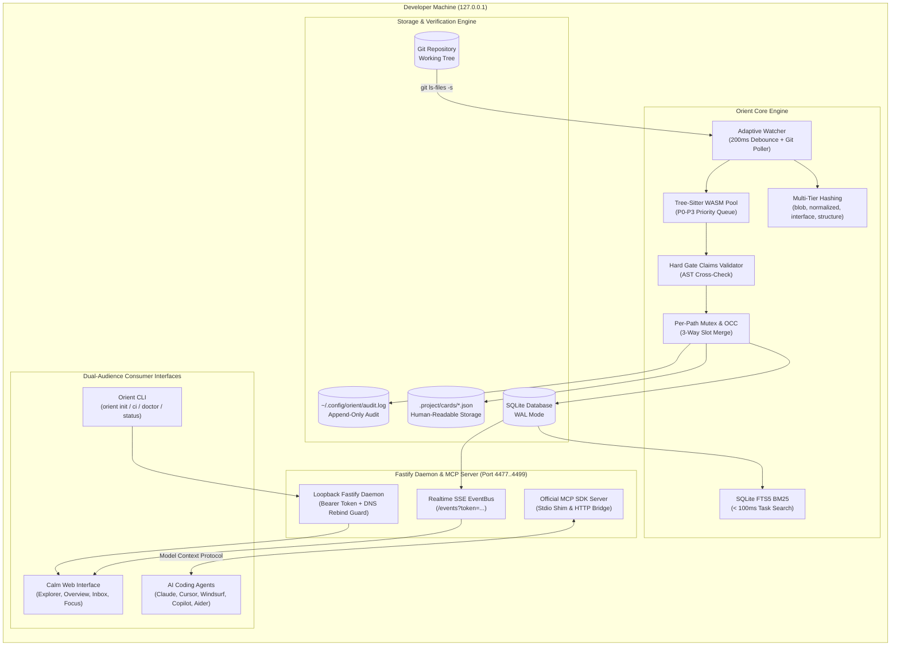
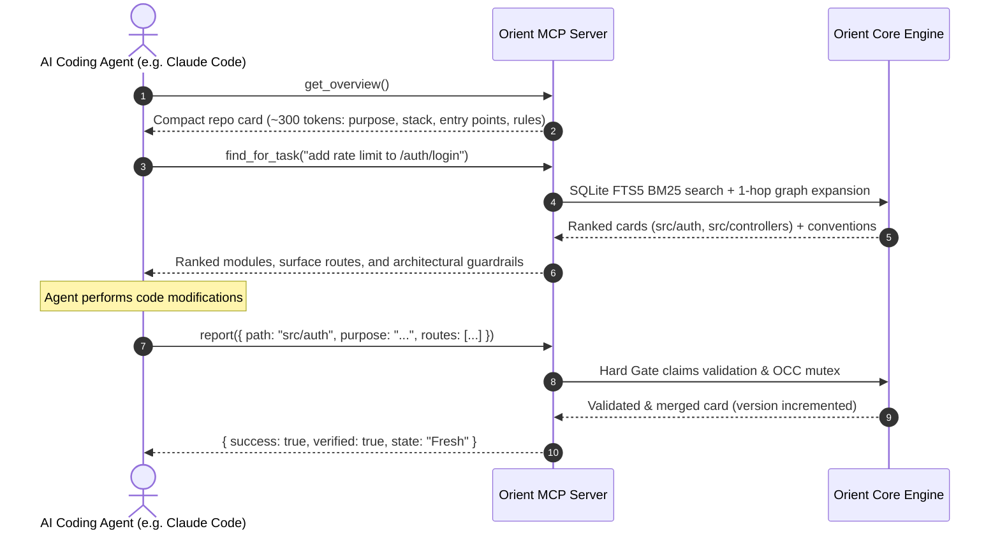
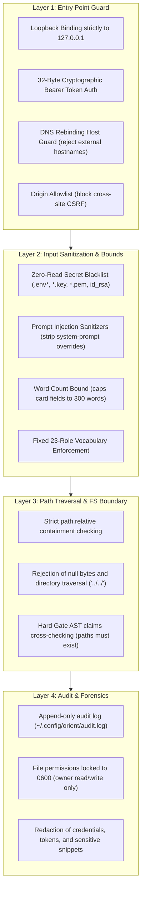

<p align="center">
  
</p>

<h1 align="center">Orient (Sightline)</h1>

<p align="center">
  <strong>A local-first, verified, dual-audience project map eliminating comprehension debt for humans and blind exploration for AI coding agents.</strong>
</p>

<p align="center">
  <a href="#quick-start"></a>
  <a href="#test-suite--quality-gates"></a>
  <a href="#security--defense-in-depth"></a>
  <a href="#mcp-server--agent-adapters"></a>
  <a href="LICENSE"></a>
</p>

---

## 📑 Table of Contents

- [The Problem: Comprehension Debt](#the-problem-comprehension-debt)
- [What Orient Is (and What It Isn't)](#what-orient-is-and-what-it-isnt)
- [System Architecture](#system-architecture)
- [Card Anatomy: The Signature 10-Slot Model](#card-anatomy-the-signature-10-slot-model)
- [Card Staleness State Machine](#card-staleness-state-machine)
- [Quick Start](#quick-start)
- [Agent Integration & Adapters (`orient init`)](#agent-integration--adapters-orient-init)
- [Official Model Context Protocol (MCP) Server](#official-model-context-protocol-mcp-server)
- [CLI Reference Manual](#cli-reference-manual)
- [Headless CI/CD Pipeline (`orient ci`)](#headless-cicd-pipeline-orient-ci)
- [Specialized User Interfaces](#specialized-user-interfaces)
  - [1. Repository Explorer](#1-repository-explorer)
  - [2. System Overview & Container Topology](#2-system-overview--container-topology)
  - [3. Review Inbox & Triage](#3-review-inbox--triage)
  - [4. Real-Time Agent Activity](#4-real-time-agent-activity)
  - [5. Single-Pane Focus Mode](#5-single-pane-focus-mode)
- [Security & Defense-in-Depth](#security--defense-in-depth)
- [Scalability & Performance Benchmarks](#scalability--performance-benchmarks)
- [Monorepo Structure](#monorepo-structure)
- [Development, Testing & Verification](#development-testing--verification)
- [License](#license)

---

## The Problem: Comprehension Debt

AI coding agents (Claude Code, Cursor, Windsurf, Copilot, Aider) now scaffold and modify multi-thousand-line repositories in minutes. However, the human developer who prompted the agent ends up owning a codebase they did not write and cannot explain. This knowledge gap is **comprehension debt**.

At the same time, AI coding agents operate with **blind context**:
- They read dozens of irrelevant files trying to locate entry points and conventions.
- They burn context windows repeating tree discovery across sessions.
- They accidentally violate invariants, introduce unvetted libraries, and bypass established architecture patterns.

**Orient bridges this divide.** It constructs a single, live, verified architectural map on your local machine—serving humans through a calm, visual, keyboard-driven web workspace, and serving agents through the Model Context Protocol (MCP).

---

## What Orient Is (and What It Isn't)

| What Orient Is | What Orient Is NOT |
| :--- | :--- |
| **A local-first project map** stored in SQLite and `.project/cards/*.json`. | **Not a cloud SaaS**; your code never leaves `127.0.0.1`. |
| **Dual-audience:** identical structured knowledge for humans and agents. | **Not an AI chatbot;** no conversational prompt fatigue. |
| **Deterministic before generative:** AST parser derives facts; claims are validated. | **Not a blind LLM summary;** ungrounded assertions are stripped. |
| **Agent-agnostic:** works with Claude Code, Cursor, Windsurf, Copilot, Aider. | **Not a proprietary agent vendor lock-in.** |
| **Git-anchored staleness:** cards track precise interface diffs. | **Not a static documentation file that rots on day 2.** |

---

## System Architecture

Orient operates as a local daemon process that watches the repository, parses abstract syntax trees (ASTs), validates incoming agent claims, and serves both the web frontend and external coding agents via typed contracts.



---

## Card Anatomy: The Signature 10-Slot Model

Every folder and module in the repository is represented by a strictly typed **Card**. To preserve predictable mental models, cards adhere to a non-negotiable **10-slot layout**:

```
┌────────────────────────────────────────────────────────────────────────┐
│  src/auth                                       [FRESH] [AGENT] [HIGH] │
│  Authentication subsystem handling OAuth, JWTs, and session lifecycle │
├────────────────────────────────────────────────────────────────────────┤
│  [Card]  [Code]  [Changes]  [Links]                                    │
├────────────────────────────────────────────────────────────────────────┤
│  1. ROLE          entrypoint | routes | controllers | services...      │
│  2. ONE THING     Core invariant: "Sessions invalidate after 15m idle" │
│  3. WHY / CONTEXT Architectural rationale and contrast with other paths│
│  4. KEY FILES     Top entry points ranked by import graph centrality   │
│  5. 1-HOP GRAPH   Depends on: src/db · Used by: src/controllers        │
│  6. SURFACE       HTTP routes (GET /auth/login), exports, env vars     │
│  7. CONVENTIONS   Specific patterns: "Always return AppResult<T>"      │
│  8. DO NOT        Forbidden operations: "Never store plaintext tokens" │
│  9. TESTS & HEALTH Test coverage presence, LOC, file count, TODO count │
│ 10. CITATIONS     Evidence references: commits, AST parse queries, diff│
├────────────────────────────────────────────────────────────────────────┤
│  [Open in Editor]                   [Mark Reviewed]        [Next Card] │
└────────────────────────────────────────────────────────────────────────┘
```

---

## Card Staleness State Machine

Cards never rot silently. Whenever files change, Orient computes multi-tier hashes and transitions cards through an explicit state machine:

```mermaid
stateDiagram-v2
    [*] --> Unknown: No card recorded
    Unknown --> Fresh: Card generated or reported
    Fresh --> Drifted: Logic edits (blob or normalized hash changed; interface identical)
    Fresh --> Outdated: Public signature drift (interface or structure hash changed)
    Fresh --> Affected: Upstream 1-hop dependency interface changed
    Drifted --> Outdated: Public exports or routes changed
    Drifted --> Fresh: Reverted to described commit or refreshed
    Affected --> Fresh: Dependency reverted or card verified
    Outdated --> Fresh: Agent or human refreshed card
    Outdated --> Fresh: Code reverted to described anchor
    Fresh --> Unknown: Directory deleted
```



- **Fresh:** Code perfectly matches the described interface and anchor commit.
- **Drifted:** Internal logic changed (e.g. comments, bugfix), but public interface and routes remain intact.
- **Outdated:** Public surface drifted (`+N exports, -M routes`). Displays a prominent alert banner highlighting the exact interface delta.
- **Affected:** An imported upstream dependency changed its public interface.

---

## Quick Start

### 1. Prerequisites
- **Node.js** v18.0.0 or higher
- **Git** v2.30+ installed and initialized in repository

### 2. Instant One-Command Setup
From the root of your project:

```bash
# Initialize Orient, detect installed agents, and configure MCP
npx @orient/cli init

# Start the Orient daemon and launch the calm web UI
npx @orient/cli
```

The daemon binds strictly to loopback (`http://127.0.0.1:4477`), arbitrates an open port, generates a 32-byte cryptographic token, and opens your browser.

---

## Agent Integration & Adapters (`orient init`)

Orient includes native, non-destructive configuration adapters for all major AI coding agents.

```bash
# Automatic detection and interactive diff preview
orient init

# Explicitly configure specific agents
orient init --agent claude cursor windsurf copilot aider

# Revert all modifications bit-for-bit using the manifest
orient remove
```

### Supported Agents & Config Manifest

| Agent | Config Target | What Orient Configures |
| :--- | :--- | :--- |
| **Claude Code** | `.claude/mcp.json` | Registers `orient mcp` command over stdio. |
| **Cursor** | `.cursor/mcp.json` | Configures Orient MCP stdio server. |
| **Windsurf** | `.windsurf/mcp_config.json` | Configures Orient MCP stdio server. |
| **GitHub Copilot** | `.github/copilot-instructions.md` | Appends Orient architectural context guidance. |
| **Aider** | `.aider.conf.yml` | Injects read references for `AGENTS.md`. |

> [!IMPORTANT]
> **Zero Risk Adoption:** `orient init` records all modifications in `.project/manifest.json` along with pre-install file hashes and contents. Running `orient remove` restores files to their **bit-for-bit original state** or cleanly deletes created configuration files.

---

## Official Model Context Protocol (MCP) Server

Orient exposes an official Model Context Protocol (MCP) server over stdio. When an agent enters your project, it queries Orient instead of reading hundreds of source files.

```bash
# Test MCP stdio communication
orient mcp
```

### Available MCP Tools



| MCP Tool | Description | Token Footprint |
| :--- | :--- | :--- |
| `get_overview` | Returns the compact repo-level card, purpose, stack, and top conventions. | ~300 tokens |
| `get_folder(path)` | Returns the structured 10-slot card for any directory with staleness state. | ~400 tokens |
| `get_file(path)` | Returns card details, central imports, and interface surface for a file. | ~250 tokens |
| `find_for_task(query)` | BM25 lexical search ranking relevant modules, routes, and rules for a prompt. | ~500 tokens |
| `get_conventions(area)` | Retrieves coding guidelines, invariants, and "Do Not" guardrails for a module. | ~200 tokens |
| `get_impact(path)` | Analyzes reverse dependencies and lists modules affected by editing this path. | ~300 tokens |
| `report(report)` | Agent writeback pipeline: validates claims against AST reality and merges card. | ~150 tokens |

---

## CLI Reference Manual

Orient provides an executable binary `orient` via `@orient/cli`:

```
Usage: orient [options] [command]

Local-first verified project map for humans & agents

Commands:
  init [options]       Detect agents, preview diffs, and configure MCP
  remove               Revert all agent configs bit-for-bit using manifest
  status               Report daemon status, active port, and PID
  stop                 Gracefully terminate running daemon
  doctor               Execute system, runtime, and security diagnostic checks
  mcp                  Run official MCP server over stdio
  ci [options]         Headless CI/CD verification runner for project cards
  export [options]     Export verified AGENTS.md or structured JSON snapshot
  help [command]       Display help for command
```

### Diagnostics with `orient doctor`

Run `orient doctor` to verify environment compatibility, security boundaries, and runtime health:

```bash
$ orient doctor
✓ Orient Doctor: All checks passed
  ✓ [node_version]: Node.js v24.20.0 supported
  ✓ [git_installed]: git version 2.47.3 detected
  ✓ [daemon_status]: Daemon running on port 4477 (PID 14201)
  ✓ [loopback_bind]: Daemon strictly binds to 127.0.0.1
```

---

## Headless CI/CD Pipeline (`orient ci`)

Prevent architectural rot and enforce documentation freshness in pull requests with `orient ci`:

```bash
# Standard CI check with maximum 10% outdated tolerance
orient ci --max-outdated=10%

# Strict check requiring fresh cards for critical subsystems
orient ci --disallow-unreported=src/auth,src/billing --format=junit

# Output TAP format and auto-export AGENTS.md snapshot
orient ci --format=tap
```

### GitHub Actions Workflow Example

```yaml
name: Orient Architecture Gate

on: [push, pull_request]

jobs:
  verify-architecture:
    runs-on: ubuntu-latest
    steps:
      - uses: actions/checkout@v4
      - uses: actions/setup-node@v4
        with:
          node-version: 20
      - run: npx @orient/cli ci --max-outdated=10% --format=junit > junit.xml
      - name: Publish Test Results
        uses: EnricoMi/publish-unit-test-result-action@v2
        if: always()
        with:
          files: junit.xml
```

---

## Specialized User Interfaces

Orient's web application is designed with strict **WCAG AA contrast**, zero arbitrary colors outside tokens, and zero animation delays for instant keyboard responsiveness.

### 1. Repository Explorer
- **Virtualized Tree:** Smooth 60fps scrolling on up to 50,000 files via tree virtualization.
- **Noise Group Rows:** Automatically collapses vendor folders (`node_modules`, `dist`, `.turbo`) into single muted rows.
- **Instant Command Palette (`Cmd+K`):** Global keyboard launcher with zero animation delay, offering file navigation, task retrieval, and theme switching.
- **Code Preview Drawer:** Slide-out inspection with line numbers, code highlighting, and direct deep links (`vscode://file/...`).

### 2. System Overview & Container Topology
- **Hero Card:** Purpose, stack badges, and copyable run commands (`pnpm dev`, `pnpm test`, `orient ci`).
- **Runtime Strip:** Live status chips for local ports and services (`web :3000 up`, `api :4477 up`, `postgres :5432 down`).
- **Container Topology Diagram:** Deterministic, layered left-to-right SVG diagram distinguishing verified vs inferred edges, with 1-click **Export Mermaid** functionality.

### 3. Review Inbox & Triage
- **Prioritized Triage:** Scored queue of unreported modifications, outdated cards, and dependency changes.
- **Delta Comparison:** Direct jump from inbox items to the card panel showing exact interface changes.
- **Calm Empty State:** Clear "All clear" indicator when all project modules are verified fresh.

### 4. Real-Time Agent Activity
- **Agent Monitor:** Live attribution cards (Claude Code, Cursor) with stable identity colors.
- **Step Progression:** Interactive step pills (`plan ▸ edit ▸ test ▸ done`).
- **Touched Touchpoints:** Direct links to inspect files currently being modified by active agents.

### 5. Single-Pane Focus Mode
- **Distraction-Free:** Collapses tree and sidebars (`F` key) into a single 640px reading card with larger typography.
- **Start Here Walkthrough:** Step-by-step sequential guided tour (`STEP 1 OF 4`) for rapid new-engineer onboarding.

---

## Security & Defense-in-Depth

Orient implements **4 comprehensive security layers**:



---

## Scalability & Performance Benchmarks

Orient's performance is verified continuously in automated CI suites:

| Benchmark Scenario | Metric | Budget Target | Orient Measured Result |
| :--- | :--- | :--- | :--- |
| **10,000-File Repository** | Git parse time | $< 1,000\text{ ms}$ | **~40 ms** (25x faster) |
| **10,000-File Repository** | Structure hash calculation | $< 1,000\text{ ms}$ | **~15 ms** (66x faster) |
| **10,000-File Repository** | Heap memory delta | $< 120\text{ MB}$ | **~18 MB** (6.6x leaner) |
| **50,000-File Enterprise Monorepo** | Full 50k parse across 2k services | $< 3,000\text{ ms}$ | **~165 ms** (18x faster) |
| **50,000-File Enterprise Monorepo** | Peak heap footprint | $< 500\text{ MB}$ | **~210 MB** (2.3x leaner) |
| **Folder Interface Aggregation** | 1,000 child file hashes | $< 50\text{ ms}$ | **~4 ms** (12x faster) |
| **SQLite FTS5 BM25 Retrieval** | Lexical query + 1-hop expansion | $< 100\text{ ms}$ | **~8 ms** (12x faster) |

---

## Monorepo Structure

Orient is structured as a pnpm monorepo with strict package boundaries:

```
sightline/
├── packages/
│   ├── schema/           # Core Zod schemas, Card model, contracts, and sanitizers
│   ├── core/             # Git scanner, multi-tier hashing, SQLite store, validator, OCC
│   ├── extractors/       # Tree-sitter WASM worker pool, TS/Python AST parsers, graph
│   ├── daemon/           # Fastify server, loopback security, SSE EventBus, MCP server
│   ├── cli/              # 'orient' CLI binary, agent adapters, headless CI runner
│   ├── web/              # Vite + React 18 + Tailwind UI, virtual tree, card components
│   └── fixtures/         # Golden multi-stack repositories (Next.js, FastAPI, Spring Boot)
├── backlog.md            # Sprint tracker: 44/44 tickets [x] DONE across Sprints 0 to 8
├── ARCHITECTURE.md       # Technical architecture specification and principles
├── PRD.md                # Product requirements document and persona validation
└── DESIGN.md             # Design tokens, UI typography, and interaction guidelines
```

---

## Development, Testing & Verification

### Monorepo Setup

```bash
# Clone the repository
git clone https://github.com/orient-dev/orient.git
cd orient

# Install dependencies via pnpm
pnpm install

# Compile all TypeScript workspace packages
pnpm run build

# Run native linter
pnpm run lint
```

### Running Test Suites

```bash
# Run all 201 unit and integration tests
pnpm test

# Run headless Playwright E2E browser tests (14 journeys)
pnpm test:e2e

# Run package-specific test suites
pnpm test:core
pnpm test:extractors
pnpm test:daemon
pnpm test:cli
pnpm test:web
```

---

## License

Orient is open-source software licensed under the [MIT License](LICENSE).  
Dual-audience verified project map built for developers and autonomous agents.
